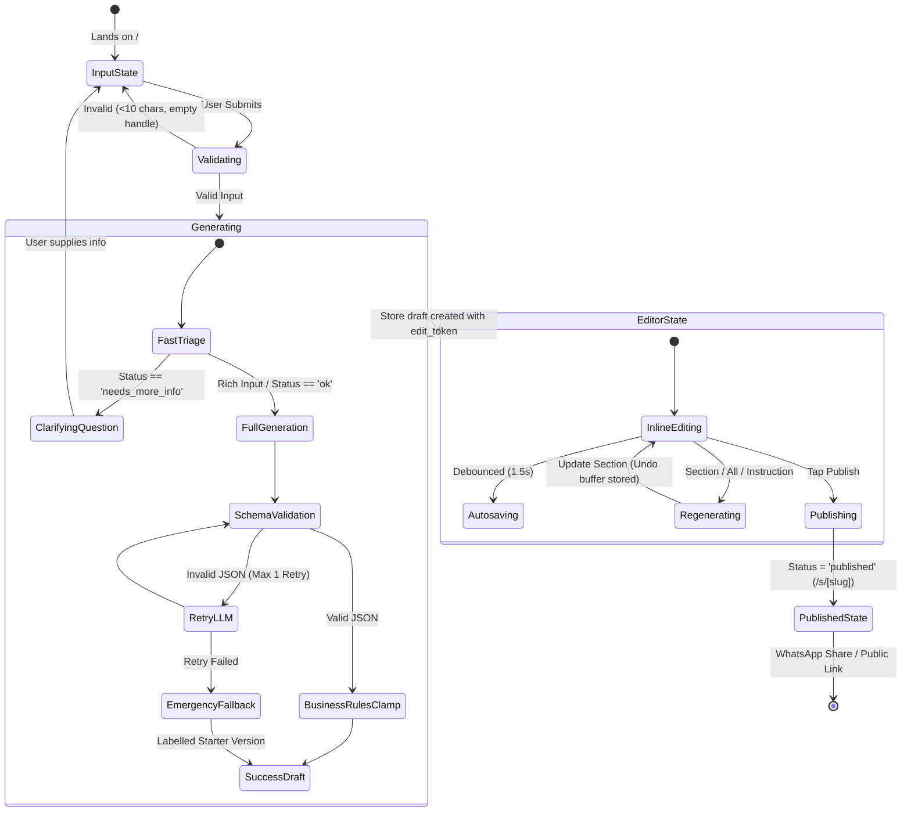
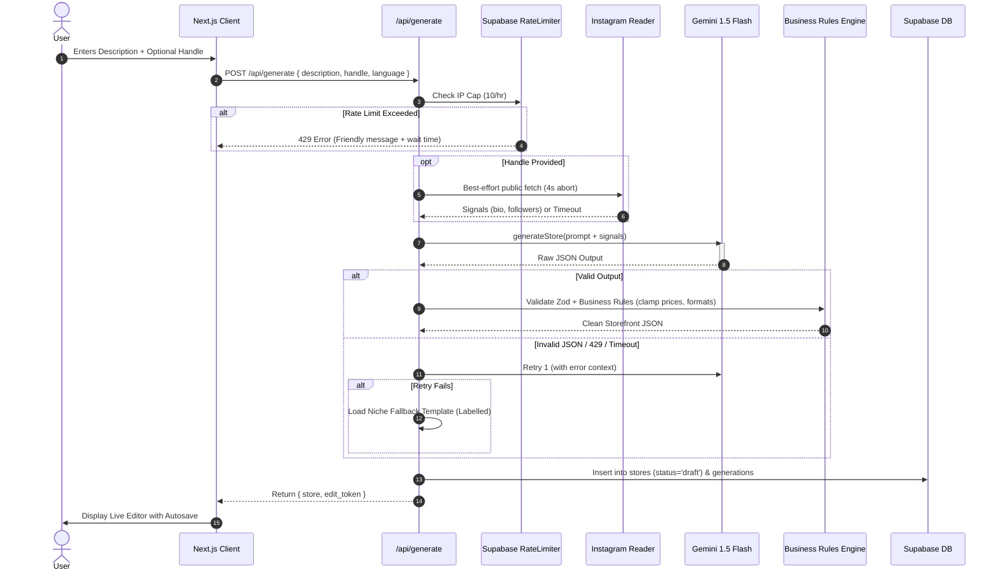
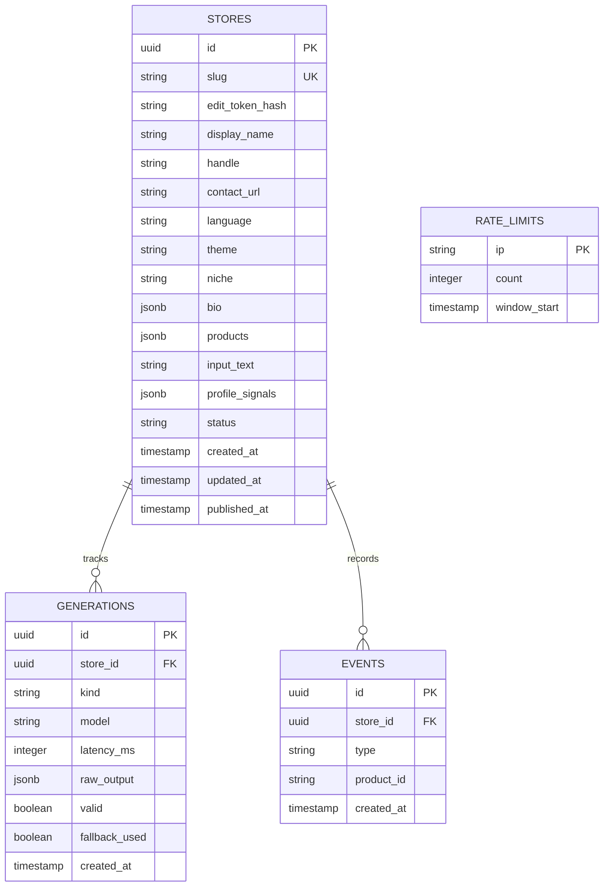

# Architecture Specification: AI Storefront Generator

**Author:** Antigravity Agent  
**Context:** SuperProfile (Cosmofeed Technologies) - Product Manager Take-Home Assignment  
**Source PRD:** [docs/PRD.md](file:///d:/assignment/docs/PRD.md)  
**Status:** Living Architectural Specification  

---

## 1. System Overview & Core Philosophy

The **AI Storefront Generator** is a mobile-first, zero-spend web application that transforms an Indian micro-creator's simple self-description (and optional Instagram handle) into a fully structured, editable, and publishable link-in-bio storefront in under 60 seconds.

### Key Architectural Principles
1. **Zero Spend / Free Tier Constraints:** Built strictly using free-tier infrastructure (Vercel Hobby, Google Gemini Flash on Google AI Studio, Supabase Free Tier Postgres).
2. **Deterministic Fallbacks & Zero Dead-Ends:** The system never fails with an unhandled error or blank screen. Every stage has structured Zod validation, retry limits, server-side rule clamping, and an emergency deterministic niche-based starter fallback.
3. **No-Auth Frictionless Access:** Uses tokenized edit sessions (`edit_token` stored in `localStorage` and private edit URL `/edit/[slug]?t=[token]`) with cryptographic hashing at rest (`edit_token_hash`).
4. **Description-First Input Architecture:** Avoids fragile Instagram scraping dependencies by treating user descriptions as primary signal and Instagram metadata as an optional best-effort signal boost with a 4-second hard cutoff.

---

## 2. High-Level System Architecture

```mermaid
flowchart TD
    subgraph Client["Client Tier (Mobile-First / Next.js 14 App Router)"]
        UI_Input["Screen 1: Input (Description + Handle)"]
        UI_Progress["Screen 2: Generating (Progress States)"]
        UI_Editor["Screen 3: Live Preview & Inline Editor"]
        UI_Public["Screen 4 & 5: Published Store (/s/[slug])"]
    end

    subgraph Edge["Vercel Edge & Serverless Runtime (API Routes)"]
        RateLimit["Rate Limiter (Supabase Table Counter)"]
        IG_Service["Instagram Scraper / Reader (4s Timeout)"]
        AI_Orchestrator["AI Orchestrator (lib/ai)"]
        Store_Service["Store & Event Manager"]
    end

    subgraph External_AI["AI Services (Free Tier)"]
        Gemini["Google Gemini Flash API (AI Studio Free Tier)"]
        Backup_LLM["Optional Fallback: Groq / OpenRouter (Free)"]
    end

    subgraph Storage["Data Tier (Supabase Postgres)"]
        DB_Stores[("stores Table")]
        DB_Generations[("generations Table")]
        DB_Events[("events Table")]
        DB_RateLimits[("rate_limits Table")]
    end

    UI_Input -->|POST /api/generate| RateLimit
    RateLimit -->|Pass| AI_Orchestrator
    AI_Orchestrator -.->|Best-effort metadata| IG_Service
    AI_Orchestrator -->|Structured Generation| Gemini
    Gemini -.->|On 429/Error| Backup_LLM
    AI_Orchestrator -->|Save Draft| Store_Service
    Store_Service --> DB_Stores
    Store_Service --> DB_Generations
    
    UI_Editor -->|PATCH /api/store/[slug]| Store_Service
    UI_Editor -->|POST /api/regenerate| AI_Orchestrator
    UI_Editor -->|POST /api/store/[slug]/publish| Store_Service

    UI_Public -->|GET /s/[slug] (SSR/ISR)| Store_Service
    UI_Public -->|POST /api/events| DB_Events
```

---

## 3. Technology Stack

| Layer | Technology | Purpose & Free-Tier Justification |
|---|---|---|
| **Framework** | Next.js 14+ (App Router, TypeScript) | Unified SSR, Route Handlers, React Server Components. |
| **Styling & UI** | Tailwind CSS + shadcn/ui primitives | Zero runtime cost, accessible components, clean mobile UI. |
| **Icons & Fonts** | Lucide React, Inter & Noto Sans Devanagari | Optimized for English, Hindi, and Hinglish typography. |
| **Primary LLM** | Google Gemini 1.5 Flash (via `@google/genai` or `@google/generative-ai`) | Fast response times (<5s), high quality Hinglish, zero cost via AI Studio. |
| **Schema Validation** | Zod | Enforces strict typing for input sanitization and LLM JSON output. |
| **Database** | Supabase Postgres (Free Tier) | Relational integrity, JSONB support for bio & products, free-tier hosting. |
| **Hosting & Deploy** | Vercel Hobby Tier | Instant deployments, edge caching, serverless route handlers. |
| **Keep-Alive** | GitHub Actions / Vercel Cron (`/api/health`) | Pings database daily to prevent Supabase 7-day auto-pause. |

---

## 4. End-to-End User Flow & State Machine



---

## 5. Detailed Component & Module Specifications

### 5.1 Project Directory Structure

```text
d:/assignment/
├── app/
│   ├── (app)/
│   │   ├── page.tsx               # Screen 1: Input Page
│   │   ├── generating/page.tsx    # Screen 2: Progress Screen
│   │   └── layout.tsx
│   ├── edit/
│   │   └── [slug]/page.tsx        # Screen 3 & 4: Inline Editor & Publish Screen
│   ├── s/
│   │   └── [slug]/page.tsx        # Screen 5: Public Storefront (SSR with OG meta)
│   ├── api/
│   │   ├── generate/route.ts      # POST: Triage, generate, draft store
│   │   ├── regenerate/route.ts    # POST: Regenerate bio or single product
│   │   ├── store/[slug]/
│   │   │   ├── route.ts           # GET & PATCH: Autosave store edits
│   │   │   └── publish/route.ts   # POST: Transition store to published
│   │   ├── events/route.ts        # POST: Record view & CTA click analytics
│   │   └── health/route.ts        # GET: Keep-alive DB ping
│   ├── layout.tsx
│   └── globals.css
├── components/
│   ├── input-form.tsx             # Textarea, handle, language chips, examples
│   ├── preview/
│   │   ├── bio-section.tsx        # Inline editable bio
│   │   ├── product-card.tsx       # Inline editable product card
│   │   ├── pricing-rationale.tsx  # "Why Rs X" expandable drawer/pill
│   │   └── theme-provider.tsx     # Theme switches (Clean, Warm, Bold)
│   ├── share-drawer.tsx           # Copy link, WhatsApp deep link, Native share
│   └── ui/                        # shadcn/ui components (buttons, dialogs, inputs)
├── lib/
│   ├── ai/
│   │   ├── client.ts              # Gemini SDK singleton wrapper
│   │   ├── prompts.ts             # System prompts, pricing matrix, few-shot examples
│   │   ├── schema.ts              # Zod schemas for Gemini structured output
│   │   ├── business-rules.ts      # Deterministic price clamping, roundings, validation
│   │   ├── fallback.ts            # Niche-based emergency starter templates
│   │   └── generate.ts            # generateStore() & regenerateSection() orchestrator
│   ├── db/
│   │   ├── client.ts              # Supabase server client (Service Role)
│   │   ├── stores.ts              # Store CRUD queries
│   │   └── rate-limiter.ts        # Supabase-backed IP request counter
│   ├── instagram/
│   │   └── reader.ts              # Best-effort public metadata scraper (4s timeout)
│   ├── utils/
│   │   ├── slug.ts                # nanoid short URL safe slug generator
│   │   └── token.ts               # SHA-256 token hasher & verifier
│   └── types.ts                   # Core TypeScript domain types
├── docs/
│   ├── PRD.md                     # Product Requirements Document
│   └── ARCHITECTURE.md            # This Document
└── public/
    └── og-default.png             # Fallback social share image
```

---

## 6. AI Subsystem & Prompt Architecture

### 6.1 Two-Step Generation Pipeline



### 6.2 Prompt Engineering & Grounding Rules
- **Role:** Product Strategist specializing in Indian micro-creators.
- **Tone & Language Control:** 
  - English (`en`), Hinglish (`hinglish` - conversational Romanized Hindi + English), Hindi (`hi` - Devanagari).
- **Anti-Hallucination & Safety Constraints:**
  - Hard constraint: INR pricing only.
  - No fabricated income guarantees ("Earn 1 lakh/month"), medical claims, or legal advice.
  - No invented testimonials or fictitious credentials.
- **Pricing Guide Embedded in Model Context:**
  - *Ebook / PDF Guide:* ₹99 – ₹499 (one-time)
  - *Template Pack:* ₹199 – ₹799 (one-time)
  - *Recorded Mini Course:* ₹499 – ₹1,999 (one-time)
  - *Cohort Course:* ₹1,499 – ₹4,999 (one-time)
  - *1:1 Mentorship Call:* ₹299 – ₹1,499 (per session)
  - *Community / Membership:* ₹99 – ₹499 (monthly)
  - *Webinar / Live Workshop:* ₹99 – ₹499 (one-time)

### 6.3 Server-Side Business Rules Post-Processing
After the model returns JSON:
1. **Format Uniqueness:** Guarantee no two products share the exact same format enum.
2. **Low-Ticket Anchor:** Ensure at least 1 product is priced under ₹500 (crucial for micro-creator conversion).
3. **Price Rounding & Clamping:** Clamped strictly to the format bounds and rounded to psychological Indian price points: `99, 149, 199, 299, 499, 699, 999, 1499, 1999`.
4. **Length Truncation:** Trim headlines (≤60 chars), descriptions (≤300 chars), bullets (≤80 chars).

---

## 7. Data Architecture & Database Schema

Supabase Postgres with Row Level Security (RLS) disabled for client SDKs and restricted purely to Server Route Handlers using `SUPABASE_SERVICE_ROLE_KEY`.



### 7.1 Security & Access Control
- **Edit Token:** Generated as a cryptographically random 32-byte hex string. Stored in client `localStorage` and URL parameters (`?t=...`).
- **Token Hashing:** Hashed using SHA-256 before insertion into `stores.edit_token_hash`. Verification compares `hash(incoming_token) === db.edit_token_hash`.
- **Public Visibility:** Stores with `status = 'published'` are publicly queryable without any token. Draft stores require a matching `edit_token`.

---

## 8. API Specifications & Contracts

### 8.1 `POST /api/generate`
* **Request:**
  ```json
  {
    "description": "Fitness coach helping desk workers lose fat without gym",
    "handle": "@fitwithaman",
    "language": "hinglish"
  }
  ```
* **Response (Success - 200):**
  ```json
  {
    "slug": "fit-desk-8x2b",
    "edit_token": "a1f9e8...",
    "store": { ... }
  }
  ```
* **Response (Needs More Info - 200):**
  ```json
  {
    "status": "needs_more_info",
    "clarifying_question": "What is the primary topic or goal you help your audience achieve?"
  }
  ```

### 8.2 `POST /api/regenerate`
* **Request:**
  ```json
  {
    "slug": "fit-desk-8x2b",
    "token": "a1f9e8...",
    "target": "product:prod_1",
    "instruction": "Make it cheaper and more beginner friendly"
  }
  ```
* **Response:**
  ```json
  {
    "target": "product:prod_1",
    "data": { ... }
  }
  ```

### 8.3 `PATCH /api/store/[slug]`
* **Headers:** `x-edit-token: a1f9e8...`
* **Request:** Partial JSON of `bio`, `products`, `display_name`, `theme`, or `contact_url`.
* **Behavior:** Debounced autosave with timestamp update.

### 8.4 `POST /api/store/[slug]/publish`
* **Headers:** `x-edit-token: a1f9e8...`
* **Response:** `{ "public_url": "https://aistorefront.vercel.app/s/fit-desk-8x2b" }`

---

## 9. Non-Functional Requirements & Resilience Strategy

1. **Free-Tier Protection:**
   - **Gemini Free-Tier Request Throttling:** 10 requests / hour per client IP. Caching of `SHA-256(description + language)` for 24 hours.
   - **Supabase Auto-Pause Mitigation:** A scheduled GitHub Action triggers `GET /api/health` once daily at 00:00 UTC, executing a lightweight `SELECT 1` query.
2. **Mobile Optimization:**
   - Designed for 360px – 390px viewports with sticky action bars and ≥44px touch targets.
   - Server-side rendering for `/s/[slug]` ensures sub-1s First Contentful Paint (FCP) and Lighthouse performance score >90.
3. **Open Graph & Social Virality:**
   - Dynamic meta tags (`og:title`, `og:description`, `og:image`) rendered in the `<head>` of `/s/[slug]`.
   - Pre-populated WhatsApp deep links (`https://wa.me/?text=...`) for instant 1-tap distribution.

---

## 10. Phased Implementation Roadmap

* **Phase 1: Foundation (1.5h):** Project init, shadcn setup, Supabase migrations, Zod schemas, `.env.example`.
* **Phase 2: AI Core Engine (2h):** Gemini Flash client, system prompts, pricing matrix, Zod structured output, business rules clamp, fallback templates, test script.
* **Phase 3: Creator Editor UI (2h):** Mobile input screen, generating skeleton, inline editable preview, autosave, per-section regenerate, undo stack.
* **Phase 4: Publishing & Public Storefront (1.5h):** Slug generator, public SSR `/s/[slug]`, OpenGraph tags, WhatsApp share links, 404 handler.
* **Phase 5: Reliability & Hardening (1h):** Supabase-backed rate limiting, Instagram 4s reader, error boundary toasts, Lighthouse mobile pass.
* **Phase 6: Polish & Stretch (1h):** Hinglish/Hindi language switcher, pricing rationale drawers, visual themes (Clean, Warm, Bold), lightweight analytics events.
